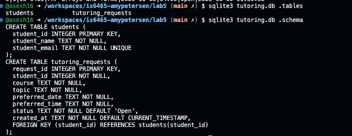
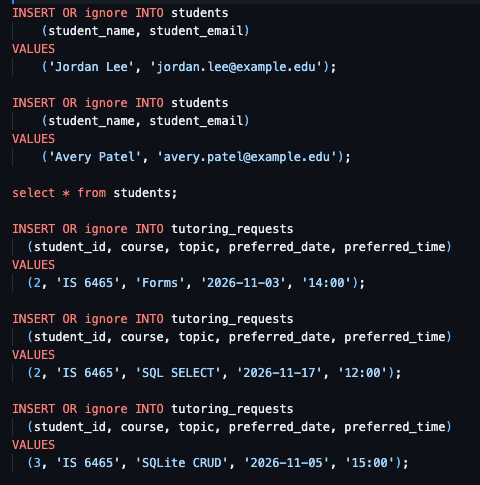
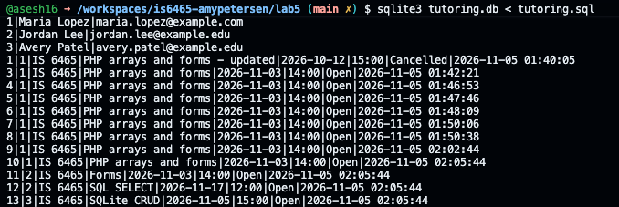
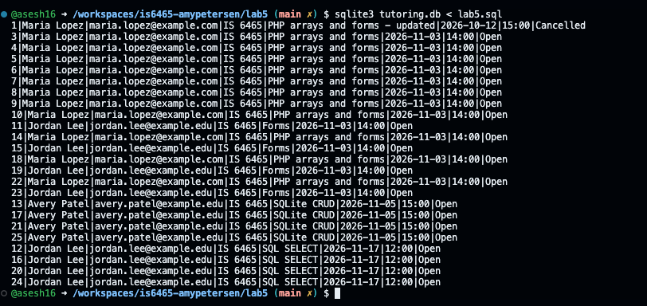
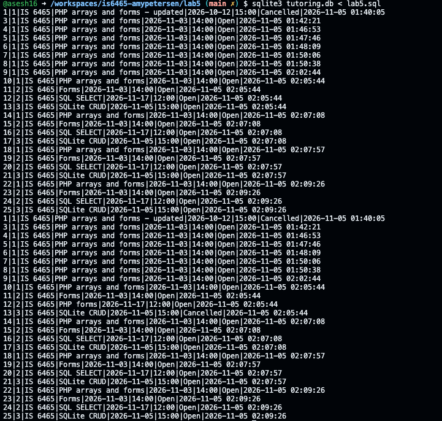
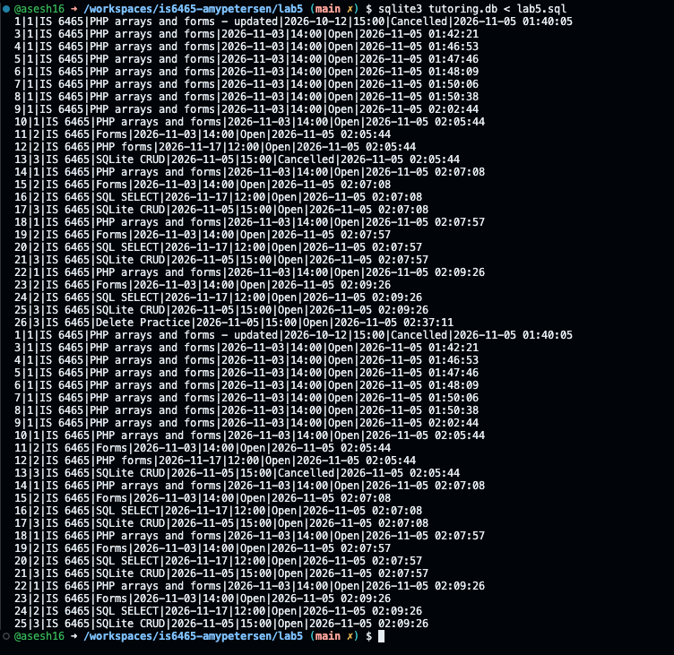

Part 1 
1. 
2. PK for students table is student_id. PK for requests table is request_id.
3. student_id is the foreign key. It it what the requests table uses to connect to and match records to in the students table. 
4. student_email is unique so that multiple students aren't registered under a sigle email address.

Part 2
1. 
2. 
3. Jordan was only created once, but a single student can submit multiple requests. We created 2 requests with differemt dates for the same student. 

Part 3
SQL:
    SELECT * from students;
    select * from tutoring_requests;

    select * from tutoring_requests 
    where status = "Open";

    select * from tutoring_requests 
    where request_id = 1;

    SELECT
    r.request_id,
    s.student_name,
    s.student_email,
    r.course, r.topic,
    r.preferred_date, r.preferred_time, r.status
    FROM tutoring_requests AS r
    JOIN students AS s ON r.student_id = s.student_id
    ORDER BY r.preferred_date;

Output of JOIN query: 

1. JOIN connects one table's PK to the other table's matching FK. 
2. JOIn is used to combine results from two tables, WHERE is used to filter results to a specific condition. 
3. By using request_id, it prevents the applicaiton from grabbing requests with the same topic. The ID is a unique value, but topic is not. 

Part 4
1. UPDATE tutoring_requests
    SET topic = 'PHP forms'
    WHERE request_id = 12;

    UPDATE tutoring_requests
    SET status = 'Cancelled'
    WHERE request_id = 13;
2. 
3. See screenshot for 2 (both the updates for before and after are in the red boxes)
4. So that the update applies to the record you want it to and not all of them
5. So that the record of it is still there and the unique ID isn't reused

Part 5
1. INSERT OR ignore INTO tutoring_requests
    (student_id, course, topic, preferred_date, preferred_time)
    VALUES
    (3, 'IS 6465', 'Delete Practice', '2026-11-05', '15:00');
2. DELETE from tutoring_requests
    where topic = "Delete Practice";

3. 
4. Because if you don't specify what to delete then everything is deleted

Part 6
CRUD Action | SQL statement | Example
- Create | INSERT INTO, VALUES | INSERT OR ignore INTO students 
                                    (student_name, student_email)
                                VALUES 
                                    ('Maria Lopez', 'maria.lopez@example.com');
- Read | SELECT | SELECT * FROM students;
- Update | UPDATE, SET, WHERE | UPDATE tutoring_requests
                            SET topic = 'PHP forms'
                            WHERE request_id = 12;
- Delete | DELETE, WHERE | DELETE from tutoring_requests
                            WHERE request_id = 2;

1. By assigning their unique student id to each request they make 
2. UNIQUE 
3. Everything is updated or deleted
4. PHP sends values as parameters so they are sent as values rather than as part of the SQL instruction, which makes the code clearer and protects against SQL injection

