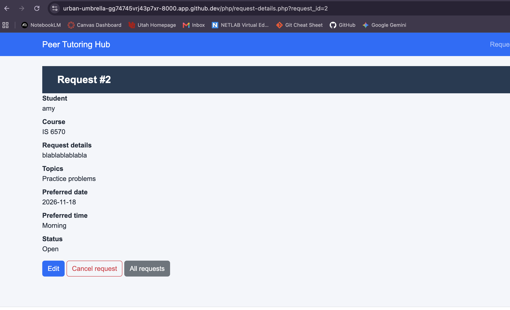

Part 2
1. https://urban-umbrella-gg74745vrj43p7xr-8000.app.github.dev/php/request-form.php
2. My request was submitted and displayed
3. 

Part 3
Test | What I Did |	Expected Result |	Actual Result |	Pass or Fail
1. Submit a valid request | Submitted a request |	A new tutoring request is created with status Open. | A new request was created successfuly with open status | Pass
2. View all requests | Pressed "all requests" button | The new request appears in the request list. | New request appeared in list | Pass
3. Filter requests | Filtered by IS 6465 | Filtering by course or status shows matching requests. | List only showed request with IS 6465 | Pass
4. Edit an Open request	| Changed preferred time from morning to afternoon | The revised values are displayed. | Request showed afternoon as I edited | Pass
5. Cancel an Open request | Cancelled request |	The request status changes to Cancelled. | The request's status changed to cancelled | Pass
6. Try to edit or cancel a cancelled request | Selected view to try to edit | The application does not allow the change. | The edit button didn't even show up as an option | Pass

Part 4
1. php/request-form.php
2. php/process-request.php
3. config/db.php (the openDatabase() function)
4. services/requestService.php (the submitRequest() function, which calls validateSubmission(), then begins a transaction and commits or rolls back)
5. repositories/studentPDO.php and repositories/requestPDO.php
6. students
7. tutoring_requests
8. Each row in tutoring_requests has a student_id column that is a foreign key to students.student_id. The service looks up the student by email, then passes that student_id when it inserts the request.

Keeping SQL in repository files means the form page only has to worry about showing HTML and the service only has to worry about rules like validation. If a table or column changes, I only have to fix it in one place instead of hunting through every page. It also makes the SQL easier to test, since the integration tests can call the same repository functions without loading a web page. Using prepared statements in one place also keeps the code safer from SQL injection.

Part 5
php tests/integration-tests.php
Xdebug: [Step Debug] Could not connect to debugging client. Tried: localhost:9000 (through xdebug.client_host/xdebug.client_port) :-(
PASS UC01 create and Open
PASS Lab 4 checkbox values preserved
PASS Duplicate email reuses student
PASS UC02 course and status filter
PASS Invalid reason rejected
PASS Invalid submission writes nothing
PASS Edit Open request
PASS Updated reason persisted
PASS Cancel Open request
PASS Cancelled row retained
PASS Second cancellation rejected
PASS Unrelated request unchanged
PASS FK enforced
PASS UC02 empty filter result
All integration checks passed

Part 6

Prompt:
Explain how a tutoring request moves from php/request-form.php through PHP, PDO, and SQLite in this project. Identify the responsibility of each file.
AI response (summary): The user fills out the form in php/request-form.php, which posts to php/process-request.php. That file checks that the request is a POST with the right hidden form name, then calls submitRequest() in services/requestService.php, passing it a PDO connection from config/db.php. The service validates the input using includes/validation.php and its own checks, then starts a transaction. Inside the transaction it calls insertStudentIfAbsent() and findStudentByEmail() in repositories/studentPDO.php, then insertTutoringRequest() in repositories/requestPDO.php. If all of that works, it commits and the user is redirected to request-details.php. If anything throws, it rolls back.
Evaluation: One accurate statement: "The service starts a transaction and rolls back if anything fails." I verified this in services/requestService.php. submitRequest() calls $pdo->beginTransaction(), then wraps the inserts in a try block, and the catch block calls $pdo->rollBack() if inTransaction() is true before rethrowing. The integration test "Invalid submission writes nothing" also supports this.

Traceability Auditor

Prompt:
Trace the requirement "a student can submit a tutoring request" through the PHP files, service, repositories, SQLite tables, and integration tests in this project.
AI response (summary): The AI traced the requirement from the form page through process-request.php, the service, the two repositories, the two tables, and the integration test that creates a request.
Evaluation: I checked each file named against the actual code and they all exist and do what the AI said. The UC01 create and Open test calls submitRequest() and then checks that the saved row has status Open.

Requirement |	Application Page |	Service or Validation |	Repository or SQL |	Database Table | Test Evidence
Student submits a tutoring request	| php/request-form.php (form) and php/process-request.php (receives POST, redirects to request-details.php)	 | services/requestService.php: validateSubmission() and submitRequest(); uses includes/validation.php (validatePreferredTime, validateTopics, validateReason) | repositories/studentPDO.php: insertStudentIfAbsent() and findStudentByEmail(); repositories/requestPDO.php: insertTutoringRequest() (INSERT INTO tutoring_requests ...) |	students and tutoring_requests	| tests/integration-tests.php: "UC01 create and Open", "Lab 4 checkbox values preserved", "Duplicate email reuses student", "Invalid reason rejected", "Invalid submission writes nothing"

Test Harness Generator
Prompt:
Suggest one useful test case for the Peer Tutoring Hub application. The test must relate to request creation, filtering, editing, cancellation, validation, or database integrity.
AI response (summary): Test that a request with a date in the past is rejected and that nothing is written to the database.
Explanation:
Already covered? Not directly. The existing tests check a too-short reason, but none of them submit a past date. The validation code does check for dates before today ($dt < new DateTimeImmutable('today') in validateSubmission()), so the behavior exists but is untested.
How I would test it: Manually, I would open the form, pick yesterday's date, and confirm I get an error and no new row shows up in the request list. To add it to tests/integration-tests.php, I would copy $sample, set preferreddate to yesterday's date, call submitRequest() inside a try/catch for InvalidArgumentException, call check(true, 'Past date rejected') in the catch, and then confirm the request count did not change.
Is it appropriate? Yes. It tests a real rule the app already enforces, it only uses functions that already exist, and it fits with the existing "Invalid reason rejected" test. It does not need anything the application does not have, like login.
Skills Pack Reflection
The AI helped me get oriented quickly by laying out which file does what, so I could then open those files and confirm it myself instead of reading every file cold. It also gave me a useful test idea I had not thought of. But the AI can only describe what it thinks the code does, and it can easily get a detail wrong, like a function name or a table count. In this lab the test counts in the starter did not match the seed data, which is exactly the kind of thing that only shows up when you run and read the real code. Developers have to check AI output against the actual code and the actual requirements, because the code is what runs and the requirements are what the work is judged against.

Part 7: Inspect the Database
Query I ran:
sql
SELECT
    r.request_id,
    s.student_name,
    s.student_email,
    r.course,
    r.topic,
    r.preferred_date,
    r.preferred_time,
    r.status
FROM tutoring_requests AS r
JOIN students AS s
    ON r.student_id = s.student_id
ORDER BY r.request_id;
What the JOIN does: The JOIN combines each row in tutoring_requests with the matching row in students by comparing r.student_id to s.student_id. That lets the result show the student's name and email next to the request details, even though the name and email are stored only in the students table. It is an inner join, so a request only appears if it has a matching student, and the results are sorted by request ID.

				
