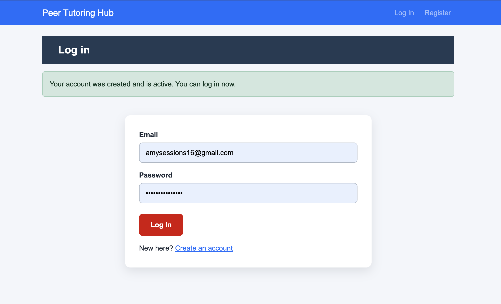
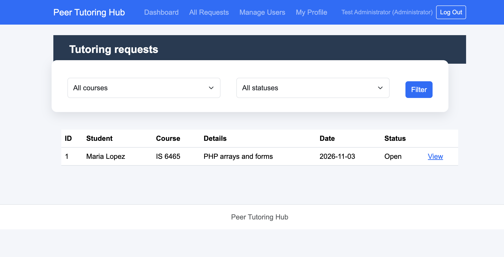

# Lab 7 Notes: Authentication and Authorization

(https://urban-umbrella-gg74745vrj43p7xr.github.dev/)

---

## Part 1: Generate the Lab 7 Application

**AI prompt used**

```
Generate code for all user management use cases UM-01 through UM-10 in the User Management Design Document.

Use the Application Builder, Test Harness Generator, and Traceability Auditor documents as implementation guidance. Follow the authentication, authorization, session management, password hashing, CSRF protection, and role based access practices in the Authentication Reading Handout.

Use lab6.zip as the existing Peer Tutoring Hub application to extend. Preserve the Lab 6 three tier architecture and update the application as needed to support user registration, login, logout, profile management, administrator access, and protected tutoring request workflows.

Return a complete Lab 7 application package with all updated and new files.
```

**Uploaded source files**

1. Peer_Tutoring_Hub_User_Management_With_Diagrams.docx (User Management Design Document)
2. skills_pack.zip (Application Builder, Test Harness Generator, Traceability Auditor)
3. IS6465_Authentication_Reading_Handout_v1.2_16Nov2026.pdf
4. lab6.zip

I missed the Authentication Reading Handout in my first upload. The first generated version followed the design document alone and linked accounts to students by email. After I uploaded the handout and the assignment page, the code was regenerated to match: `students.user_id`, the handout's access matrix, a 20 minute timeout, and a separate `upgrade-to-user-management.sql`.

**How Lab 7 extends Lab 6**

Lab 7 keeps the Lab 6 three-tier structure (pages in `php/`, rules in `services/`, SQL in `repositories/`) and adds user accounts on top of it. The upgrade script creates a `users` table and adds `students.user_id`, so each student profile links to a login account. New pages handle registration, login, logout, profile editing, password changes and administrator user management. Every Lab 6 tutoring request page now runs a shared guard from `includes/auth.php` before doing anything. Students can only reach their own requests, administrators can see all of them, and every form that changes data checks a CSRF token.

**One generated item I verified against the handout**

Handout section 8 says the application should call `session_regenerate_id(true)` after a successful login, so a session ID issued before login can't be reused. I checked `includes/auth.php`: `establishUserSession()` starts on line 63 and calls `session_regenerate_id(true)` on line 64. It then stores `user_id`, `display_name` and `role` in `$_SESSION`. In `php/login.php`, `establishUserSession()` is only called on line 14, after `authenticateUser()` succeeds on line 13. So the ID only changes for a verified login, which matches the handout.

---

## Part 2: Set Up the Database

```
cd lab7/database
sqlite3 tutoring.db < setup-database.sql
sqlite3 tutoring.db < upgrade-to-user-management.sql
sqlite3 tutoring.db
.tables
.quit
```

All three tables appeared: `students`, `tutoring_requests` and `users`.

```
SQLite version 3.34.1 2021-01-20 14:10:07
Enter ".help" for usage hints.
sqlite> .tables
students           tutoring_requests  users
sqlite> .quit
```

---

## Part 3: Create an Administrator Account

Command structure (password not shown):

```
php create-admin.php "Test Administrator" admin@example.com "<test password, 12+ characters>"
```

The administrator account was created. The script printed:

```
Administrator account created: admin@example.com (role: Administrator, user_id 1).
```

(Codespaces also printed an Xdebug notice saying it couldn't connect to a debugging client. That message comes from the environment's debugger, not from the script.)

- **Email used:** admin@example.com
- **Role assigned:** Administrator

---

## Part 4: Run the Application

From the `lab7` folder: `php -S 0.0.0.0:8000`, then I opened port 8000 from the Ports tab.

- **URL opened:** https://urban-umbrella-gg74745vrj43p7xr-8000.app.github.dev/php/login.php
- **Result:** the application opened successfully.
- **Without logging in:** Visiting the site sent me to the login page with the message "Please log in to continue." `index.php` redirects to `php/dashboard.php`, and that page's `requireLogin()` guard redirects anyone without a session to `login.php`.

---

## Part 5: Student Workflow

| Test | What I Did | Expected Result | Actual Result | Pass or Fail |
|---|---|---|---|---|
| Register student account | Registered a student account | Student account is created | Student account was created | pass |
| Log in as student | Logged in as student | Student can access protected student pages | successful login | pass |
| View or update profile | viewed profile | Profile information is displayed or saved | profile was displayed | pass |
| Create tutoring request | created a tutoring request | A new request is created with status Open | a new request was successfuky created | pass |
| Edit Open request | selected edit on an open request | Updated request information is displayed | updated info was displayed | pass |
| View my requests | went to view requests page | Student sees the student's own requests | viewed own requests | pass |
| Log out | selected log out | Session ends and login page appears | logged out | pass |



---

## Part 6: Administrator Workflow



**1. What is authentication in this application?**
Authentication is how the app confirms who I am. When I submit the login form, `authenticateUser()` looks up my account by email and checks my password against the stored hash with `password_verify()`. If both checks pass, the app starts a new session holding my `user_id`, so later pages know it's me without asking for the password again.

**2. What is authorization in this application?**
Authorization is what I'm allowed to do once I'm logged in. Each protected page calls `requireRole()` with the roles it allows. For tutoring requests, the SQL also checks ownership (`s.user_id = ?`). The app reloads my role and status from the database on every request, so if an admin changes my role or deactivates me, the change takes effect on my next click.

**3. How is student access different from administrator access?**
A student can submit tutoring requests and can only view, edit and cancel their own. If a student types in another student's request ID, the app returns "Request not found." An administrator can't submit requests, but can see every student's requests, edit or cancel any Open request, and manage user accounts.

**4. Which functions or pages should be limited to administrators?**
The user management pages: `admin-users.php` (list and search users), `admin-user-details.php`, `admin-update-role.php`, `admin-account-status.php` and `admin-delete-user.php`. Viewing other students' requests and editing or cancelling requests that aren't your own are also admin-only. The service layer checks admin status again inside `searchUsers()`, `updateUserRole()`, `updateUserStatus()` and `deleteUserAccount()`, so the pages aren't the only protection.

**5. What happens after logout if a user tries to visit a protected page directly?**
They're sent to the login page. Logout clears the session data, expires the session cookie and destroys the server-side session. When the user types a protected URL, `requireLogin()` finds no `user_id` and redirects to `login.php`. Even if someone replays the old session cookie, the server no longer has a session for it.

---

## Part 7: Trace Registration and Login

In this app there's no separate controller file. `register.php` and `login.php` each show their form on GET and handle their own POST, so each page acts as its own controller and hands the work to the service layer.

**Student registration workflow**

1. **Which file displays the Create Account form?** `php/register.php` (GET request)
2. **Which file receives the submitted registration form?** `php/register.php` (POST request). It calls `requireGuest()` on line 4, `requireValidCsrf()` on line 10, then `registerUser()` on line 15.
3. **Which file or function creates and verifies the CSRF token?** `includes/auth.php`. `csrfToken()` (line 169) creates a random 64-character token and stores it in the session. `csrfField()` (line 177) writes it into the form as a hidden field. `requireValidCsrf()` (line 185) verifies it, calling `isValidCsrfToken()` (line 181), which compares the values with `hash_equals()`.
4. **Which service validates the registration information?** `services/userService.php`: `registerUser()` calls `validateRegistration()` (name, email, role) and `validateNewPassword()` (12+ characters, passwords match). It also rejects duplicate emails.
5. **Where is the password hashed?** In `hashPassword()` in `services/userService.php` (line 82), which calls `password_hash($password, PASSWORD_DEFAULT)`. `registerUser()` calls it before the insert.
6. **Which repository files insert user and student data?** `repositories/userPDO.php` `insertUser()` inserts the account. `repositories/studentPDO.php` `insertStudentForUser()` inserts the linked student row (or `linkStudentToUser()` when an existing Lab 6 student row has the same email).
7. **Which database tables receive records when a student registers?** `users` and `students`, inside one transaction, with `students.user_id` pointing to the new account.

**User login workflow**

1. **Which file displays the login form?** `php/login.php` (GET request)
2. **Which file receives the submitted login credentials?** `php/login.php` (POST request). It verifies the CSRF token on line 10, then calls `authenticateUser()` on line 13.
3. **Which repository retrieves a user by email address?** `repositories/userPDO.php` `findUserCredentialsByEmail()`, using a prepared statement.
4. **Where is the submitted password verified?** In `authenticateUser()` in `services/userService.php`, with `password_verify()`. Inactive accounts and wrong passwords get the same "Invalid email or password." message.
5. **What session actions occur after successful login?** `establishUserSession()` in `includes/auth.php` regenerates the session ID with `session_regenerate_id(true)` and clears any old session data. It stores `user_id`, `display_name`, `role`, `login_time` and `last_activity`, and creates a new CSRF token. `login.php` then redirects to `dashboard.php`.
6. **Why should the application regenerate the session ID after login?** To prevent session fixation. If an attacker got me to use a session ID they already knew before I logged in, and the ID stayed the same, that ID would become a logged-in session they could use. A new ID at login makes any pre-login ID worthless.
7. **How does the application determine whether the logged in user is a student or administrator?** From the `role` column in the `users` table. On every request, `currentUser()` reloads my account from the database using the `user_id` in the session, and `requireRole()` checks `$user['role']` against the roles the page allows. The role never comes from the browser.

**Why password hashing and verification belong in the application layer**

Hashing and verification are business rules, so they belong in the service layer where every page goes through the same code. If `register.php` hashed passwords itself, every page that creates or changes a password would need its own copy, and one could easily get it wrong. The database setup script only builds tables. It never sees a submitted password, and SQLite has no equivalent of `password_hash()` or `password_verify()`. Keeping it in `userService.php` means the page never stores or compares a raw password, and the repository only ever receives a finished hash.

---

## Part 8: Automated Tests

**Validation tests**

```
php tests/validation-tests.php
```
```
<p>Valid time: PASS</p><p>Missing time: PASS</p><p>Altered value: PASS</p><p>Multiple valid topics: PASS</p><p>Missing topics: PASS</p><p>Altered topic: PASS</p><p>Minimum length: PASS</p><p>Maximum length: PASS</p><p>Too short: PASS</p><p>Too long: PASS</p>
```
Result: **passed**, 10 of 10 checks.

**User management tests**

```
php tests/user-management-tests.php
```
```
PASS: UM-01-T1 Valid Student registration creates Active user
PASS: UM-01-T2 Password stored only as a verifiable hash
PASS: UM-01-T3 Confirmation password not stored
PASS: UM-01-T4 Valid Tutor registration creates Active user
PASS: UM-01-T5 Email normalized to lowercase
PASS: UM-01-T5a Student registration creates linked students row (users + students)
PASS: UM-01-T5b Tutor registration creates no students row
PASS: UM-01-T5c 11-character password rejected (12 minimum)
PASS: UM-01-T6 Duplicate email rejected
PASS: UM-01-T7 Duplicate email rejected regardless of case
PASS: UM-01-T8 Public registration cannot assign Administrator
PASS: UM-01-T9 Password mismatch rejected
PASS: UM-01-T10 Short password rejected
PASS: UM-01-T11 Invalid email rejected
PASS: UM-01-T12 Missing name rejected
PASS: UM-01-T13 Failed registrations created no accounts
PASS: UM-01-T14 Quotes and special characters stored exactly (encoded on output)
PASS: UM-SETUP Administrator created through CLI bootstrap only
PASS: UM-SETUP Administrator has no students row
PASS: UM-09-T1 Valid login returns account without hash
PASS: UM-09-T2 Login email is case-insensitive
PASS: UM-09-T3 Wrong password rejected
PASS: UM-09-T4 Unknown email gives the same generic message
PASS: UM-02-T1 Own profile shows name, email, role and status
PASS: UM-02-T2 Profile data excludes password hash
PASS: UM-02-T3 Missing or expired session account denied
PASS: UM-04-T1 Name and email update succeeds
PASS: UM-04-T2 Role and status modification through profile denied
PASS: UM-04-T3 Linked STUDENTS row follows the name/email change
PASS: UM-04-T4 Ownership of existing requests kept after email change
PASS: UM-04-T5 Duplicate email rejected
PASS: UM-04-T6 Email owned by another student record rejected
PASS: UM-04-T7 Invalid email rejected
PASS: UM-04-T8 Rejected updates changed nothing
PASS: UM-05-T1 Incorrect current password rejected
PASS: UM-05-T2 New password mismatch rejected
PASS: UM-05-T3 Failed attempts left hash unchanged
PASS: UM-05-T4 Valid change succeeds
PASS: UM-05-T5 New password works
PASS: UM-05-T6 Old password fails
PASS: UM-03-T1 Admin sees all accounts with no filters
PASS: UM-03-T2 Admin search returns matching accounts
PASS: UM-03-T3 Role and status filters combine
PASS: UM-03-T4 No matches returns empty list
PASS: UM-03-T5 LIKE wildcard treated literally
PASS: UM-03-T6 Search results exclude password hashes
PASS: UM-03-T7 Student denied user search
PASS: UM-03-T8 Tutor denied account details
PASS: UM-03-T9 Invalid filter value rejected
PASS: UM-03-T10 Account details include related request count
PASS: UM-06-T1 Unauthorized role change denied (Student actor)
PASS: UM-06-T2 Unauthorized role change denied (Tutor actor)
PASS: UM-06-T3 Denied change made no update
PASS: UM-06-T4 Invalid role value rejected
PASS: UM-06-T5 Admin cannot change own role
PASS: UM-06-T6 Admin promotes Tutor to Administrator
PASS: UM-06-T7 Admin changes role back to Tutor
PASS: UM-06-T8 Same-role change reported as no change
PASS: UM-07-T1 Non-admin status change denied
PASS: UM-07-T2 Admin deactivates account
PASS: UM-07-T3 Inactive user cannot log in (generic message)
PASS: UM-07-T4 Inactive account has no admin authority
PASS: UM-07-T5 Invalid transition (already Inactive) rejected
PASS: UM-07-T6 Admin cannot deactivate self
PASS: UM-07-T7 Reactivated user can log in again
PASS: UM-07-T8 Admin can deactivate another admin when one remains
PASS: UM-07-T9 Exactly one active administrator remains
PASS: UM-07-T10 Deactivated admin loses authority
PASS: UM-08-T1 Non-admin delete denied
PASS: UM-08-T2 Deletion blocked by related tutoring records
PASS: UM-08-T3 Blocked delete removed no users or requests
PASS: UM-08-T4 Dependent tutoring request retained
PASS: UM-08-T5 Admin cannot delete self
PASS: UM-08-T6 Unknown account reported
PASS: UM-08-T7 Account with no related records deleted
PASS: UM-08-T7a Empty linked students row removed with it
PASS: UM-08-T8 Exactly one account removed
PASS: UM-10-T1 currentUser() source data reflects deactivation immediately
Results: 78 passed, 0 failed
```
Result: **passed**, 78 passed and 0 failed.

**Integration tests**

```
php tests/integration-tests.php
```
```
PASS: UC01 create and Open
PASS: Lab 4 checkbox values preserved
PASS: Duplicate email reuses student
PASS: UC02 course and status filter
PASS: Invalid reason rejected
PASS: Invalid submission writes nothing
PASS: Edit Open request
PASS: Updated reason persisted
PASS: Cancel Open request
PASS: Cancelled row retained
PASS: Second cancellation rejected
PASS: Unrelated request unchanged
PASS: FK enforced
PASS: UC02 empty filter result
PASS: L7-R01 Registration links the existing student row through students.user_id
PASS: L7-R02 Student sees own requests
PASS: L7-R03 Student sees no other student requests
PASS: L7-R04 Administrator sees all requests
PASS: L7-R05 Tutor denied request list
PASS: L7-R06 Owner can load own request
PASS: L7-R07 Other student gets not found (ownership in SQL)
PASS: L7-R08 Tutor cannot load requests
PASS: L7-R09 Administrator can load any request
PASS: L7-R10 Only Students may create requests
PASS: L7-R11 Posted name/email ignored; identity comes from account
PASS: L7-R12 Tutor submission rejected
PASS: L7-R13 Administrator submission rejected
PASS: L7-R14 Non-owner edit rejected
PASS: L7-R15 Non-owner cancel rejected
PASS: L7-R16 Rejected edit/cancel changed nothing
PASS: L7-R17 Administrator can edit any Open request
PASS: L7-R18 Owner cancel works
PASS: L7-R19 Quoted and special characters stored exactly
PASS: L7-R20 escapeHtml still encodes output
Results: 34 passed, 0 failed
```
Result: **passed**, 34 passed and 0 failed.

All three test groups passed, so no failed tests needed investigating. Codespaces printed an Xdebug notice before each run ("Could not connect to debugging client"). That comes from the environment's debugger, not from the tests, so I left it out of the pasted output.

---

## Part 9: AI Skills Pack Process

I used Claude as the AI tool for all three prompts.

### Application Builder

**Prompt:**
> Explain how a student registration request moves from register.php through authentication checks, PHP services, repositories, PDO, and SQLite in the Peer Tutoring Hub application. Identify the responsibility of each file or layer.

**AI response:**

1. **Browser → `php/register.php` (presentation tier).** The page shows the Create Account form on GET, with a hidden CSRF token from `csrfField()`. On POST it is the entry point: it collects the input, calls the service, and either redirects to the login page with a confirmation or redisplays the form with errors. It contains no SQL and no password logic.
2. **Authentication checks (`includes/auth.php`).** Before any work, `requireGuest()` sends already logged-in users to the dashboard, and `requireValidCsrf()` compares the posted token with the session token using `hash_equals()`. A missing or wrong token stops the request with a 403.
3. **Service (`services/userService.php`, application tier).** `registerUser()` normalizes the email to lowercase and validates the name, email format, password length (12+) and confirmation match. It only allows Student or Tutor as the role, so the public form can't create an Administrator, and it checks for duplicate emails. It hashes the password with `hashPassword()` (`password_hash`, `PASSWORD_DEFAULT`) and opens a transaction so the account and student profile are saved together or not at all.
4. **Repositories (`repositories/userPDO.php`, `repositories/studentPDO.php`, data access tier).** `insertUser()` inserts the account with the hash, role and Active status. `insertStudentForUser()` inserts the linked student row with `user_id`. Every value is bound through a prepared statement.
5. **PDO (`config/db.php`).** `openDatabase()` creates the PDO connection with exceptions turned on and foreign keys enabled. Prepared statements send SQL and values separately, which prevents SQL injection.
6. **SQLite (`database/tutoring.db`).** The `users` table stores the account. Its UNIQUE email and CHECK constraints on role and status act as a final safety net. The `students` table stores the profile, linked by `students.user_id`. The transaction commits and the page redirects to `login.php`.

**Accurate statement I verified:** "The password is hashed in the service layer by `hashPassword()`, not in `register.php`." I opened `services/userService.php` and found `hashPassword()` on line 82, which returns `password_hash($password, PASSWORD_DEFAULT)`. Inside `registerUser()`, the call `insertUser(..., hashPassword($data['password']), ...)` passes only the hash to the repository. I searched `php/register.php` and it has no call to `password_hash`, so the statement is accurate.

### Traceability Auditor

**Prompt:**
> Trace the requirement "a student can register, log in, create a tutoring request, and log out" through the presentation pages, authentication code, services, repositories, SQLite tables, and automated tests in this project.

**AI response (summary):** The AI traced each step through every layer and produced the table below. It also noted that logout has no repository or table step, because it only ends the server-side session. It pointed out that logout isn't fully tested by the three required test files; the end-to-end logout tests are in the extra file `tests/http-smoke-tests.php`.

**My evaluation:** I checked every function name in the table against the source files and each one exists where the table says. The logout point is accurate. The only logout test in `user-management-tests.php` (UM-10-T1) checks that a deactivated account is caught, not the logout itself. The full "access denied after logout" check is H-43 in `http-smoke-tests.php`.

| Requirement | Presentation Page | Authentication or Authorization | Service or Validation | Repository or SQL | Database Table | Test Evidence |
|---|---|---|---|---|---|---|
| Student registers an account | `php/register.php` | `requireGuest()`, `requireValidCsrf()` | `registerUser()`, `validateRegistration()`, `validateNewPassword()`, `hashPassword()` | `insertUser()`, `insertStudentForUser()` | users, students | UM-01-T1 to T14, UM-01-T5a |
| Student logs in | `php/login.php` | `requireValidCsrf()`, `establishUserSession()` (regenerates ID) | `authenticateUser()` (`password_verify`) | `findUserCredentialsByEmail()` | users | UM-09-T1 to T4 |
| Student creates a tutoring request | `php/request-form.php`, `php/process-request.php` | `requireRole(['Student'])`, `requireValidCsrf()` | `submitRequestForUser()`, `validateSubmission()` | `findStudentByUserId()`, `insertTutoringRequest()` | students, tutoring_requests | L7-R10 to R13, UC01 create and Open |
| User logs out | `php/logout.php` (POST from the nav bar) | `requireValidCsrf()`, `restartFreshSession()` → `endSession()` | none | none | none (server session only) | UM-10-T1; H-42 to H-46 in `tests/http-smoke-tests.php` |

### Test Harness Generator

**Prompt:**
> Suggest one useful test case for authentication or authorization in the Peer Tutoring Hub application. The test must relate to registration, login, logout, session protection, role based access, password validation, CSRF protection, or account status.

**AI response:** Test the 20-minute inactivity timeout. Log in as a student, then simulate 21 minutes of inactivity by setting `$_SESSION['last_activity']` to `time() - 1260`. Request a protected page such as `requests.php`. Expected result: the session ends, the browser is redirected to `login.php`, and the message "Your session expired. Please log in again." appears. A second case sets `last_activity` to 19 minutes ago and confirms the page still loads, which proves the timeout isn't too aggressive.

**1. Is it already covered by the provided test files?** No. None of the three required test files check the timeout, and neither does `http-smoke-tests.php`. The timeout code is `enforceSessionTimeouts()` in `includes/auth.php`, with `SESSION_IDLE_TIMEOUT = 1200`, so this is a real gap.

**2. How I would test it:** Manually, I'd temporarily change `SESSION_IDLE_TIMEOUT` to 60 seconds, log in, wait two minutes, click My Requests, and confirm I land on the login page with the expired message. Then I'd change it back to 1200. To automate it, I'd add a check that sets up a session with `user_id` and an old `last_activity`, calls `enforceSessionTimeouts()`, and asserts that `$_SESSION['user_id']` is gone and the flash message mentions "expired."

**3. Is the test appropriate?** Yes. Handout section 10 requires a 20-minute inactivity timeout, and the handout's session security table lists "idle browser" as a risk this control addresses. Testing just under and just over the limit checks both sides of the rule, so it tests a requirement rather than just the code.

### Skills Pack Reflection

The AI was most useful for tracing. It walked through registration file by file and connected each layer to the right function, which would have taken me a lot longer to piece together alone. It also helped me find a gap in the tests, since nothing covered the inactivity timeout. Verifying its output mattered, though. The first version it generated didn't match the reading handout: it linked accounts to students by email instead of `students.user_id`, and it gave tutors access to requests. I only caught that because I compared the code to the handout and the lab instructions. AI explanations and code can sound right and still be wrong for your specific requirements, so I treat its output as a draft I check against the source and the documentation.

---

## Part 10: Inspect the Database

```
sqlite3 database/tutoring.db
```
```sql
SELECT
    u.user_id,
    u.full_name,
    u.email,
    u.role,
    u.status,
    s.student_id,
    s.student_name,
    s.student_email
FROM users AS u
LEFT JOIN students AS s
    ON u.user_id = s.user_id
ORDER BY u.user_id;
```

Query results: 
1|Test Administrator|admin@example.com|Administrator|Active|||
2|Amy Petersen|amysessions16@gmail.com|Student|Active|2|Amy Petersen|amysessions16@gmail.com


**1. What the LEFT JOIN does:** It returns every row from `users`, whether or not there's a matching row in `students`. When a user has a student profile, the student columns are filled in. When there's no match, those columns come back empty (NULL). An inner JOIN would drop users without a student row, so the administrator wouldn't appear at all.

**2. How the users table connects to the students table:** Through `students.user_id`, which is a foreign key pointing to `users.user_id`. It's UNIQUE, so each account has at most one student profile. The upgrade script added it with `ALTER TABLE students ADD COLUMN user_id INTEGER REFERENCES users(user_id)` and a unique index.

**3. Why account information is stored separately from student profile information:** Login data and student data serve different purposes and apply to different people. `users` holds what every account needs to authenticate: email, password hash, role and status. `students` holds the profile that tutoring requests attach to. Keeping them separate means administrators and tutors can have accounts without a fake student profile. It also kept the Lab 6 `students` and `tutoring_requests` tables mostly intact, and keeps password hashes out of the tables the request pages query.

**4. Why an administrator account may not have a matching row in the students table:** An administrator isn't a student and never submits tutoring requests, so there's nothing for a student profile to hold. `create-admin.php` only inserts into `users`, and only Student registrations create a `students` row. That's why the admin's student columns come back empty in the LEFT JOIN.
